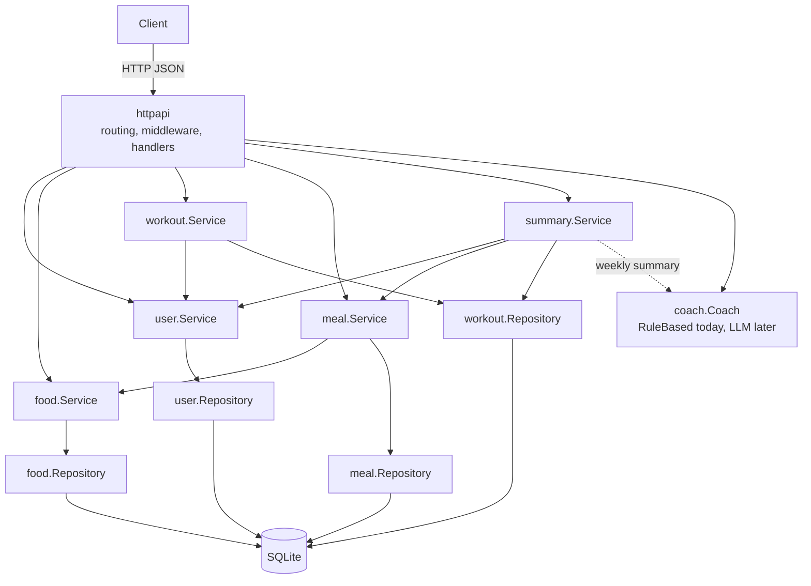

# FitTrack API

A fitness and calorie tracker REST API with a rule-based coach, written in Go.
Users log workouts and meals, get a daily and weekly energy balance against a
personal calorie target, and receive short coaching messages in Indonesian.

It is a single static binary with an embedded SQLite database, embedded
migrations and an embedded food seed: nothing else to deploy.

## Features

- Register and login (bcrypt + JWT), profile with sex, birth date, height,
  weight, activity level and goal
- Calorie target from Mifflin-St Jeor BMR and an activity multiplier, with a
  deficit capped at 500 kcal/day that never drops below BMR
- Workout log with calories estimated as `MET x weight (kg) x hours`
- Meal log with calories and macros computed from a food table
- Food table seeded with common Indonesian foods, plus per-user custom foods
- Daily and weekly summaries, and a weekly coach behind a `Coach` interface

## Architecture



| Path | Responsibility |
| --- | --- |
| `cmd/api` | Composition root, HTTP server, graceful shutdown |
| `internal/config` | Environment configuration |
| `internal/httpapi` | Routes, middleware, thin handlers, JSON error format |
| `internal/auth` | Password hashing and JWT |
| `internal/user` | Accounts, profiles, BMR / TDEE / target |
| `internal/food` | Food table, seed loader, custom foods |
| `internal/workout` | Workout log, MET table |
| `internal/meal` | Meal log, nutrition math |
| `internal/summary` | Daily and weekly summaries |
| `internal/coach` | `Coach` interface and rule-based rules |
| `internal/store` | SQLite connection, migrations, driver error mapping |
| `internal/domain` | Shared errors, validation, dates, pagination |
| `migrations` | goose SQL migrations (embedded) |
| `docs/openapi.yaml` | API contract |

Handlers translate HTTP to service calls, services hold the rules,
repositories hold the SQL. There is no global state: everything is wired in
`httpapi.New` from explicit dependencies, including the clock.

## Running

Requirements: Go 1.27+ (the version in `go.mod`). No C compiler is needed.

```bash
cp .env.example .env          # then set JWT_SECRET (at least 32 bytes)
export $(grep -v '^#' .env | xargs)
make run                      # or: go run ./cmd/api
```

Migrations and the food seed are applied automatically at startup. To apply
them without serving: `make migrate`.

With Docker (or Podman, which reads the same files):

```bash
JWT_SECRET=$(openssl rand -base64 48) docker compose up --build
```

| Variable | Default | Purpose |
| --- | --- | --- |
| `JWT_SECRET` | none, required | HS256 signing key, at least 32 bytes |
| `HTTP_ADDR` | `:8080` | Listen address |
| `DATABASE_PATH` | `fittrack.db` | SQLite file |
| `JWT_TTL` | `24h` | Token lifetime |
| `BCRYPT_COST` | `10` | Password hashing cost |
| `LOG_LEVEL` | `info` | `debug`, `info`, `warn`, `error` |
| `APP_TIMEZONE` | `Asia/Jakarta` | Timezone that decides when a day starts |

Development commands: `make test`, `make lint`, `make fmt`, `make build`.

## API examples

The full contract is in [docs/openapi.yaml](docs/openapi.yaml).

```bash
BASE=http://localhost:8080/api/v1

# Register (returns a token) and keep the token
TOKEN=$(curl -s -X POST $BASE/auth/register \
  -d '{"email":"budi@example.com","password":"a-long-password"}' | jq -r .token)
AUTH="Authorization: Bearer $TOKEN"

# Profile: returns BMR, TDEE and the daily target
curl -s -X PUT $BASE/profile -H "$AUTH" -d '{
  "sex":"male","birth_date":"1996-06-15","height_cm":175,"weight_kg":70,
  "activity_level":"moderate","goal":"lose","weekly_workout_goal":3}'

# Find a food, then log a meal
curl -s "$BASE/foods?q=nasi" -H "$AUTH"
curl -s -X POST $BASE/meals -H "$AUTH" -d '{
  "date":"2026-11-16","meal_type":"lunch",
  "items":[{"food_id":1,"grams":200},{"food_id":2,"grams":100}]}'

# Log a workout: calories_burned is computed
curl -s -X POST $BASE/workouts -H "$AUTH" \
  -d '{"activity":"running","duration_min":30,"distance_km":5,"date":"2026-11-16"}'

# Summaries and coach
curl -s "$BASE/summary/daily?date=2026-11-16" -H "$AUTH"
curl -s "$BASE/summary/weekly?week_start=2026-11-16" -H "$AUTH"
curl -s "$BASE/coach/weekly" -H "$AUTH"
```

Errors always have the same shape:

```json
{
  "error": {
    "code": "validation_failed",
    "message": "one or more fields are invalid",
    "details": [{ "field": "height_cm", "message": "must be between 50 and 280" }]
  }
}
```

List endpoints take `limit` (1-100, default 20) and `offset`, and return
`{"data": [...], "pagination": {"limit", "offset", "total"}}`.

## Domain rules

- **BMR**: Mifflin-St Jeor, `10*kg + 6.25*cm - 5*age + 5` (male) or `- 161`
  (female).
- **TDEE**: BMR x activity multiplier (1.2, 1.375, 1.55, 1.725, 1.9).
- **Target**: lose = `max(TDEE - 500, BMR)`, maintain = TDEE, gain =
  `TDEE + 300`.
- **Calories burned**: MET x weight x hours. MET values come from the 2011
  Compendium of Physical Activities; codes are cited in
  [internal/workout/met.go](internal/workout/met.go).
- **Remaining**: `target - calories_in + calories_burned`.
- **Coach rules** (thresholds are named constants in
  [internal/coach/rules.go](internal/coach/rules.go)): no logs for the last 2+
  days, workouts below the weekly goal, net intake above 110% or below 80% of
  target on 3+ days, average protein below 0.8 g/kg, and an intake swing above
  40% of target between consecutive logged days. Every response carries a
  disclaimer that it is general guidance, not medical advice.

## Design decisions and trade-offs

- **goose over golang-migrate.** goose runs on the existing `database/sql`
  handle, so it reuses the pure-Go SQLite driver, supports `embed.FS` through
  its provider API with no global state, and keeps up and down in one file.
- **modernc.org/sqlite, no CGO.** Static binary and a tiny container image, at
  the cost of somewhat lower performance than the C library. WAL mode, a busy
  timeout and immediate write transactions are set per connection.
- **Standard library router.** Go's `ServeMux` method and wildcard patterns
  cover this API; no router dependency.
- **Workout calories are stored, meal nutrition is computed on read.** A
  workout keeps the estimate made with the weight at logging time. Meal totals
  follow the food table, so correcting a food fixes past meals too; this is
  why a food that is used in a meal cannot be deleted.
- **404 for other users' resources.** Ownership is part of every query, so
  another user's data is indistinguishable from data that does not exist.
- **Dates are calendar dates.** Clients send the local date they mean; the
  server only needs a timezone to know what "today" is.
- **Coach rules are pure functions** over a weekly summary, which makes them
  trivially table-testable and lets an LLM coach implement the same interface.
- **Formatting.** Go files use tabs because `gofmt` mandates them; every other
  file uses spaces (see `.editorconfig`).

## Testing

```bash
make test    # go test -race ./...
make lint    # golangci-lint run
```

Unit tests cover BMR, TDEE, target, MET calories, nutrition math, config,
tokens, timezone handling and every coach rule (table-driven). Integration
tests start the real handler against a temporary SQLite file and cover auth,
profile, foods, workouts, meals, daily and weekly summaries, the coach, and
the authorization boundary between two users.

## Known limitations

- **Food macros are in whole grams.** The 13 seeded rows match the online TKPI
  database (panganku.org) as read on 2026-11-16, and each row cites its TKPI
  code. That site shows protein, fat and carbohydrate truncated to whole
  grams, so macros can be up to 1 g per 100 g lower than the printed table.
  See [internal/food/seed/README.md](internal/food/seed/README.md).
- Exercise is counted twice if the activity level already includes the logged
  workouts, because TDEE includes habitual activity. Pick the activity level
  for daily life outside logged workouts.
- One MET value per activity; intensity and pace are not modelled.
- No weight history: summaries of past weeks use the current target.
- One timezone per deployment, not per user.
- No rate limiting, refresh tokens, password reset or email verification.
- A wrong HTTP method on a known path answers 404 rather than 405.
- SQLite fits a single instance; it does not scale horizontally.

## Roadmap

1. Grow the food seed and take macro decimals from the printed TKPI.
2. Weight log and target history.
3. LLM coach behind the existing `Coach` interface, with the rule-based coach
   as fallback.
4. Rate limiting and refresh tokens.
5. Per-user timezone.
6. PostgreSQL option behind the repositories.
